

<a href="https://www.linkedin.com/in/malaika-azhar-tech">
  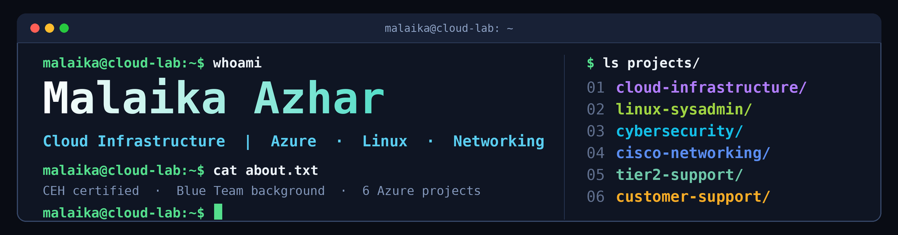
</a>

 

 

## 👩‍💻 About

I am targeting **Cloud Infrastructure Engineer and DevOps roles**, building on Microsoft Azure, Linux and a strong networking foundation. Cloud security is my longer-term goal.

I spent my Cyberster internship doing SOC and detection engineering work (Wazuh SIEM, Suricata IDS, pfSense, threat intelligence, forensics), and I earned the CEH certification. That security background shapes how I build Azure infrastructure: least-privilege access, locked-down network rules, and log-based verification with KQL. Every project is backed by a README, the commands I ran, a cleanup script and screenshot evidence, including the failed attempts.

I am studying Computer Science at Virtual University of Pakistan (expected 2027).

 

## 🧪 Featured Projects

<table>
<tr>
<td width="33%" align="center" valign="top">
<a href="https://github.com/malaika-azhar/Cloud-Infrastructure-Engineering">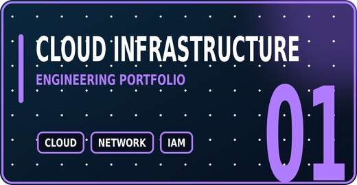</a>
 Cloud infrastructure projects: virtual machines, networking, storage, identity and access, monitoring, load balancing
</td>
<td width="33%" align="center" valign="top">
<a href="https://github.com/malaika-azhar/Linux-SysAdmin-Labs">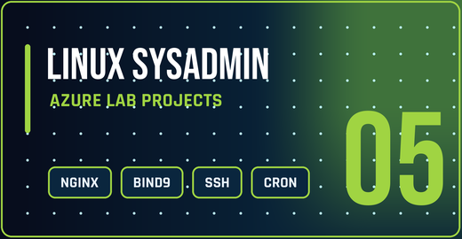</a>
 Backup/restore, Nginx TLS, SSH hardening, BIND9 DNS, user offboarding, monitoring on Azure Ubuntu
</td>
<td width="33%" align="center" valign="top">
<a href="https://github.com/malaika-azhar/Cybersecurity-Lab-Projects">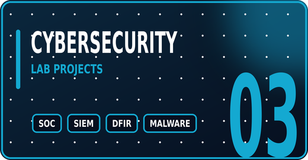</a>
 SOC, SIEM triage, DFIR, malware analysis, threat mapping
</td>
</tr>
<tr>
<td width="33%" align="center" valign="top">
<a href="https://github.com/malaika-azhar/Cisco-Networking-Lab-Portfolio">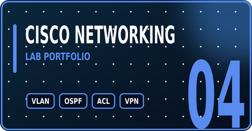</a>
 26 labs: VLANs, OSPF/EIGRP, ACLs, IPsec VPN, port security, Samba4 AD
</td>
<td width="33%" align="center" valign="top">
<a href="https://github.com/malaika-azhar/Real-World-Tier2-Support-Projects">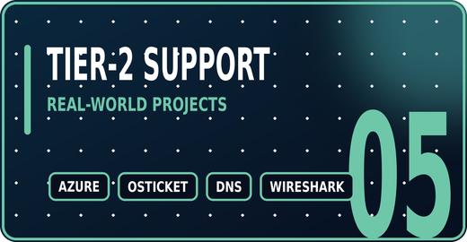</a>
 osTicket helpdesk on Azure, SPF/DKIM/DMARC audit, Wireshark fault analysis
</td>
<td width="33%" align="center" valign="top">

 Ticket simulations, troubleshooting flowcharts, escalation scripts
</td>
</tr>
</table>

 

## ☁️ Azure Cloud Infrastructure Engineering

Six Azure projects in one repository: [Cloud-Infrastructure-Engineering](https://github.com/malaika-azhar/Cloud-Infrastructure-Engineering)

| Project | What I built and tested |
|---|---|
| Virtual Machines | Ubuntu 24.04 VM with SSH key login, 4 GB data disk mounted by UUID (still mounted after reboot), VM resize, stopped vs deallocated comparison |
| Virtual Networking | VNet with 2 subnets and 2 NSGs, SSH limited to one IP, rules tested with IP flow verify, VNet peering |
| Storage | Blob tiers, soft delete and versioning recovery, SAS tokens (200 then 403), storage firewall, Azure Files over SMB |
| Entra ID and RBAC | Users and groups, RBAC tested as a real user, custom role, managed identity reading a Key Vault secret, resource lock, Azure Policy deny rule |
| Monitor and Log Analytics | Azure Monitor Agent, KQL to find failed SSH logins, metric and log alerts that fired, saved workbook |
| Load Balancer | Standard Load Balancer with 2 private nginx servers behind 1 public IP, failover and recovery tested |

 

## 🌐 Networking (my strongest area)

26 labs in Cisco Packet Tracer, each with topology, configuration, verification and a Limitations section: [Cisco-Networking-Lab-Portfolio](https://github.com/malaika-azhar/Cisco-Networking-Lab-Portfolio)

| Track | Labs | What I covered |
|---|---|---|
| Core networking | 11 | VLSM and CIDR (172.16.0.0/20 split across 3 buildings and 3 WAN links), multi-VLAN DHCP, inter-VLAN routing, VLAN troubleshooting, OSPF (single and multi-area), EIGRP, RIP, static routing, OSPF/EIGRP redistribution, NAT/PAT, HSRP failover and failback, centralized syslog |
| Network security | 6 | Standard and extended ACLs, AAA, SSH hardening, port security with STP loop prevention, IPsec site-to-site VPN |
| IT support | 9 | AD, DNS, email, gateway IP conflict, LAN/Wi-Fi, printing, RDP/VPN, system diagnostics, Windows Update |

This is the base under my Azure work: the same ideas (subnetting, routing, NSG rules, peering, load balancing) I first built and broke in Packet Tracer.

 

## 🔐 Security in My Azure Projects

My Blue Team background shows in how I build. These are tested results from the projects above, not just configuration:

- **Network:** NSGs per subnet with SSH allowed only from one IP, checked with IP flow verify (Deny then Allow)
- **Identity:** RBAC tested as a real user, custom role, managed identity reading a Key Vault secret instead of a stored password
- **Governance:** resource lock and an Azure Policy deny rule
- **Data protection:** SAS tokens (200 then 403), storage firewall, soft delete and versioning recovery
- **Detection:** Azure Monitor Agent and KQL to find failed SSH logins, with metric and log alerts that fired

 

## 🐧 Linux and Systems

Six labs on an Azure Ubuntu VM: [Linux-SysAdmin-Labs](https://github.com/malaika-azhar/Linux-SysAdmin-Labs)

- Backup and restore with a script, checksums and cron, tested by deleting live data on purpose and restoring it
- Nginx reverse proxy with TLS
- SSH hardening with firewall and patching
- BIND9 DNS server
- User management and offboarding
- Disk and uptime monitoring

 

## 🏅 Certifications

I earned the **Certified Ethical Hacker (C|EH)** credential from EC-Council in September 2026. It sits alongside Cisco's Introduction to Cybersecurity and IBM's Cybersecurity Fundamentals.

<a href="https://aspen.eccouncil.org/Verify">
  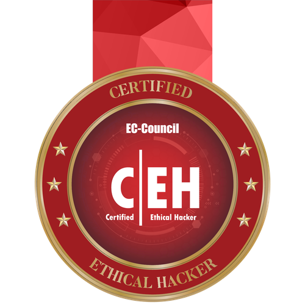
</a>

**Certified Ethical Hacker (C|EH)** · EC-Council · September 2026 · Certificate No. `ECC7025643981` · [Verify credential →](https://aspen.eccouncil.org/Verify)

 

## 🛠️ Skills

| Area | Tools and topics |
|---|---|
| Cloud (Azure) | Virtual Machines, Virtual Network, NSGs, Storage, Entra ID, RBAC, Key Vault, Azure Monitor, Log Analytics, Load Balancer, Azure Policy |
| Linux and systems | Ubuntu Server, Nginx and TLS, BIND9 DNS, SSH hardening, firewall, cron, Bash, Samba4 Active Directory |
| Networking | TCP/IP, DNS, DHCP, VLANs, inter-VLAN routing, OSPF, EIGRP, ACLs, Wireshark, Cisco Packet Tracer |
| Security and detection | Wazuh SIEM, Suricata IDS, pfSense, MITRE ATT&CK, KQL log analysis, SIEM alert triage, DFIR, SPF/DKIM/DMARC, Nmap, Kali Linux |
| Tools | Git, GitHub, Python, osTicket, Vue 3, Node.js |

 

## 🛡️ SOC and Detection Engineering

**Cybersecurity Intern, Blue Team** · Cyberster · Jun 2026 to Sep 2026

- Deployed a Wazuh SIEM with File Integrity Monitoring and custom detection rules on Ubuntu and Windows endpoints.
- Wrote and tested Suricata IDS rules and integrated the alerts into Wazuh.
- Added threat intelligence feeds (VirusTotal, URLhaus, MITRE ATT&CK) to the SIEM.
- Did malware analysis and digital forensics: disk imaging, Prefetch, registry and timeline correlation.
- Documented every week in a report (12 weekly reports) and loaded a URLhaus feed of 20,000+ malicious URLs into Wazuh.
- After patching openssh on a monitored endpoint, re-scanned and confirmed findings on that package dropped from 30 to 6.

**Lab architecture:** a Wazuh Manager collects events from an Ubuntu server, a Windows host, a Suricata IDS on Kali Linux and a pfSense firewall, with threat intelligence added on top and alerts shown on a SOC dashboard.

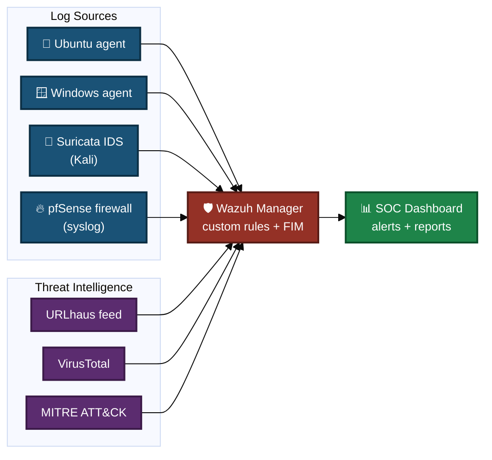

<table>
<tr>
<td width="50%" align="center">
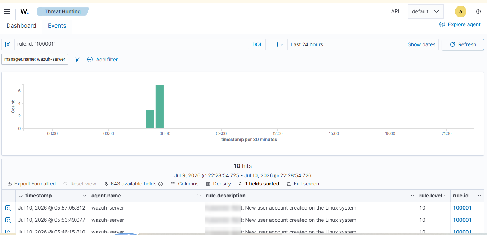
 <b>Custom rule 100001:</b> alert fires when a new Linux user account is created
</td>
<td width="50%" align="center">
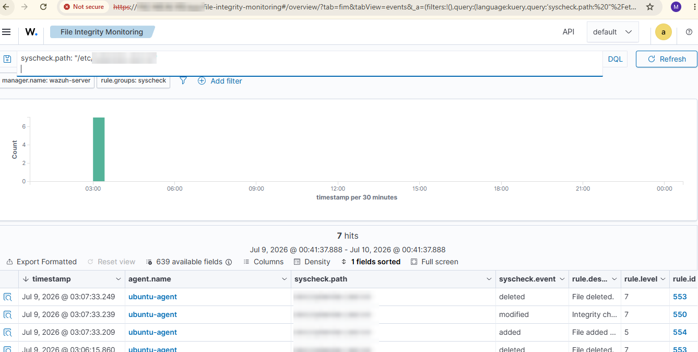
 <b>File Integrity Monitoring:</b> file added, modified and deleted events detected
</td>
</tr>
</table>

 

## 🗓️ Journey

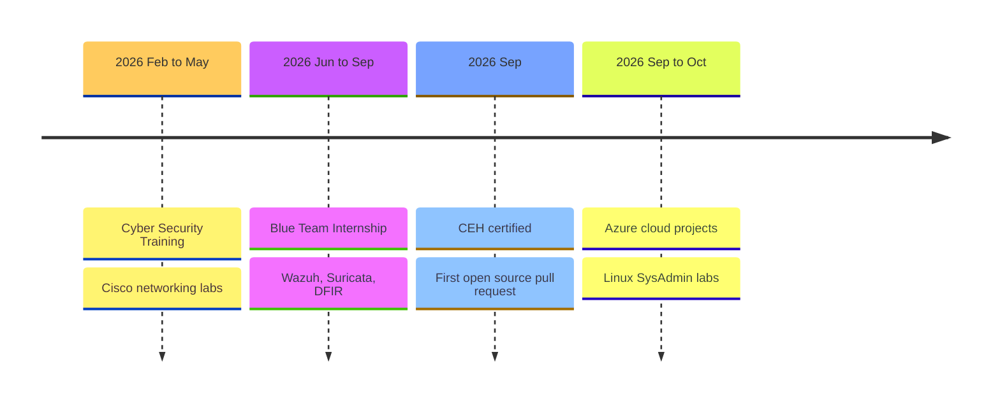

 

## 🤝 Open Source

Pull request to Uptime Kuma fixing drag-and-drop of monitors out of a group hierarchy (Vue 3, Node.js, Vite).

 

## 🎯 Career Goal

I am looking for a **Cloud Infrastructure Engineer** or **DevOps** role (intern or junior), where I can keep building Azure and Linux infrastructure on real systems. My longer-term goal is **cloud security**, combining that work with my Blue Team background.

 

## 📬 Contact

[LinkedIn](https://www.linkedin.com/in/malaika-azhar-tech) · [malaikawork21@gmail.com](mailto:malaikawork21@gmail.com)
